# NeuroGraph

An EEG mental-health research pipeline that ends in a knowledge graph: resting-state EEG from people with and without depression is cleaned, turned into brain-rhythm biomarkers, modelled with honest person-wise validation, and stored with full provenance in Neo4j. On top sits a knowledge-verified student-support assistant for the university: a LangGraph agent that answers from PII-redacted public university pages, the study graph and NLI-verified PubMed claims, uses a QLoRA fine-tuned Qwen2.5-3B, checks every answer against its sources before showing it, sends distress messages to a fixed referral, and runs as a CPU demo with monitoring.

> **Research and screening prototype. Not a diagnostic tool.** No new human data was collected; all EEG comes from a public, de-identified OpenNeuro dataset.

| Phase | What | Status |
|---|---|---|
| 0–1 | Kaggle setup, dataset audit, labels | ✅ |
| 2 | Preprocessing: filtering, ICA + ICLabel, epoching, AutoReject | ✅ 120/120 subjects |
| 3 | Features: band power, FAA, IAF, regions | ✅ 157 per person |
| 4 | Models: baselines, permutation tests, calibration, EEGNet, 32/19-channel caps, MLflow | ✅ |
| 5 | Study graph in Neo4j AuraDB + 10 Cypher queries | ✅ |
| 6 | university pages with PII redaction, search index, policy graph, PubMed literature graph | ✅ 100 passages, 0 PII leaks, 16 verified claims |
| 7 | QLoRA fine-tune of Qwen2.5-3B, GGUF export | ✅ |
| 8 | LangGraph agent (safety node, graph verification), FastAPI + Streamlit demo with logs and feedback | ✅ Space files ready |
| 9 | Evaluation: gold questions, RAGAS, base vs fine-tuned vs a larger reference model, human audit | ✅ (audit ratings pending) |

---

## Where to find things

| Part | Code | Results |
|---|---|---|
| Preprocessing: filtering, ICA + ICLabel, epochs, AutoReject | [`src/neurograph/eeg/`](src/neurograph/eeg) | [QC](reports/results.md#2-preprocessing-qc-commit-4531cf3-120120-subjects-0-failures) |
| Features: band power, FAA, alpha peak, regions | [`eeg/features.py`](src/neurograph/eeg/features.py) | [features](reports/results.md#3-features-commit-17b8949) |
| Models: logistic regression, XGBoost, EEGNet, calibration | [`models/`](src/neurograph/models) | [all results](reports/results.md#4-models) |
| Risk tiers | [`models/calibrate.py`](src/neurograph/models/calibrate.py) | [risk tiers](#risk-tiers-and-the-dass-21) |
| Study graph (Neo4j) | [`graph/`](src/neurograph/graph) | [10 queries](src/neurograph/graph/queries.py) |
| university intake: fetch, clean, Presidio PII redaction, chunks, Qdrant | [`ingest/`](src/neurograph/ingest) | [intake + retrieval](reports/results.md#6-university-intake-search-index-and-graphs) |
| Literature graph: PubMed claims, NLI check, replication in our data | [`literature/`](src/neurograph/literature), [`agent/replication.py`](src/neurograph/agent/replication.py) | [claims + replication](reports/results.md#64-literature-graph-scriptsbuild_literature_graphpy) |
| QLoRA fine-tune and GGUF export | [`scripts/train_qlora.py`](scripts/train_qlora.py), [`finetune/`](src/neurograph/finetune) | [base vs QLoRA](reports/results.md#7-qlora-fine-tune-local-run-rtx-5060-ti-16-gb) |
| Agent: safety node, router, verifier | [`agent/`](src/neurograph/agent) | [gold questions](reports/results.md#81-agent-on-the-24-gold-questions-scriptsrun_agent_evalpy-neo4j-with-the-study-policy-and-literature-graphs) |
| Demo app (FastAPI + Streamlit) and Space | [`app/`](src/neurograph/app), [`space/`](space) | [demo](#demo) |
| Evaluation: benchmark, RAGAS, human audit | [`scripts/run_benchmark.py`](scripts/run_benchmark.py), [`eval/`](eval) | [evaluation](#evaluation) |

## Key findings

| model (person-level AUC, 50 folds) | AUC |
|---|---|
| majority class / sex only | 0.500 / 0.602 |
| **sex + eyes-closed EEG (pre-declared headline)** | **0.671 ± 0.105** |
| eyes-closed EEG with sex regressed out | 0.633 ± 0.100 (permutation p = 0.030) |
| EEGNet on raw EEG (same 15 folds as LR 0.665) | 0.653 ± 0.111 |
| same model, 32-channel / 19-channel cap | 0.669 / 0.658 |

1. **There is a modest EEG signal for depression, and most of it is not sex.** DEP participants are 73% female vs 53% of controls, and sex alone gives AUC 0.60. Removing sex's effect from every feature inside the training folds lowers EEG from 0.667 to 0.633, still above 97% of shuffled-label runs.
2. **Deep learning does not help at n = 120.** EEGNet matches band-power logistic regression and overfits within ~2 epochs; an independent rerun on other hardware gave 0.686 (Δ +0.021 ± 0.125 vs LR), inside the noise in both runs.
3. **A 32- or 19-channel cap loses nothing measurable** (ΔAUC within ±0.013): the signal is broad and regional, so it does not need a dense 64-channel cap.
4. **Calibration fixes the percentages, not the separation.** Platt scaling inside folds brings mean predicted risk from 0.47 to the true 0.375 (slope 0.66 → 1.04), but almost nobody reaches "high risk", and the score does not track severity within DEP.
5. **The classic frontal alpha asymmetry finding does not replicate** here (F4–F3 slightly positive in DEP, opposite to the usual direction).

Assistant (details in [LLM and RAG assistant](#llm-and-rag-assistant)):

6. **Fine-tuning taught the task's format more than facts.** On 55 held-out university questions from chunks never seen in training, QLoRA raised citing the right passage from 18% to 89%, answers entailed by the source from 61% to 84%, and correct "the passages don't say" from 45% to 82%; it also made a quarter of its answers terse fragments.
7. **Keep the adapter where it was trained.** Trained on university policy prompts only, it improved policy answers (11/11) but hurt study and literature answers, so the agent uses it on the policy route and the base model elsewhere (17/18 gold facts vs 16/18 base).
8. **Graph verification needs more than NLI.** The sentence-level NLI check missed a swapped higher/lower direction and an over-generalised AI-policy rule; a direction check against the effects computed in Python now catches the first kind.
9. **Every distress or crisis message went to the referral, and no normal question did** (6/6 and 0/18, every model).

Full tables with commits: [`reports/results.md`](reports/results.md).

## Pipeline

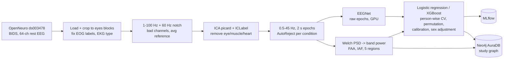

- **Validation:** StratifiedGroupKFold by person, 5 folds × 10 repeats, the same folds for every model; imputation, scaling, C tuning, sex adjustment and calibration are all fitted inside training folds only; no feature selection on the full data.
- **Honesty checks:** majority and sex-only baselines, paired fold-by-fold comparisons, 200-shuffle permutation tests, a sensitivity run without QC-flagged people, a women-only model, and a pre-declared headline model to avoid picking the best of many.
- **Reproducibility:** fixed seeds, YAML configs, git hash stored on every pipeline run, MLflow runs for every Phase 4 model; an independent rerun from the raw download on another machine reproduces Phases 1–3 exactly and every Phase 4 conclusion ([section 4.7](reports/results.md#47-independent-local-rerun-of-phases-15-2026-10-21)).

## Figures

| | |
|---|---|
| 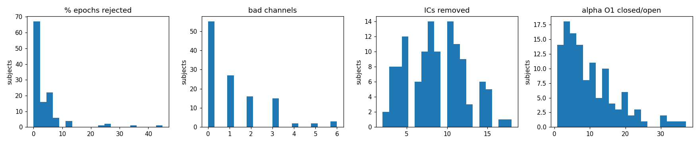 Preprocessing QC, 120 subjects | 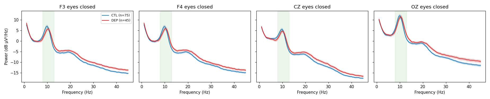 Eyes-closed spectra, CTL vs DEP |
| 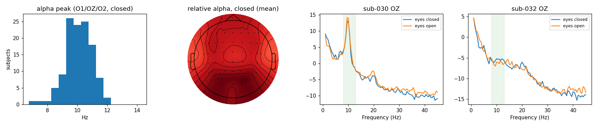 Alpha-peak sanity checks | 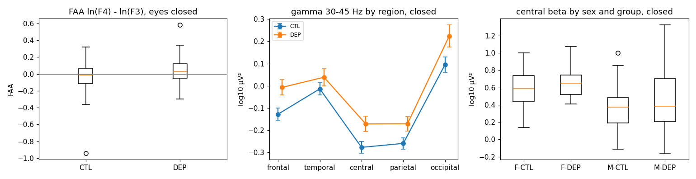 FAA, muscle and sex checks |
| 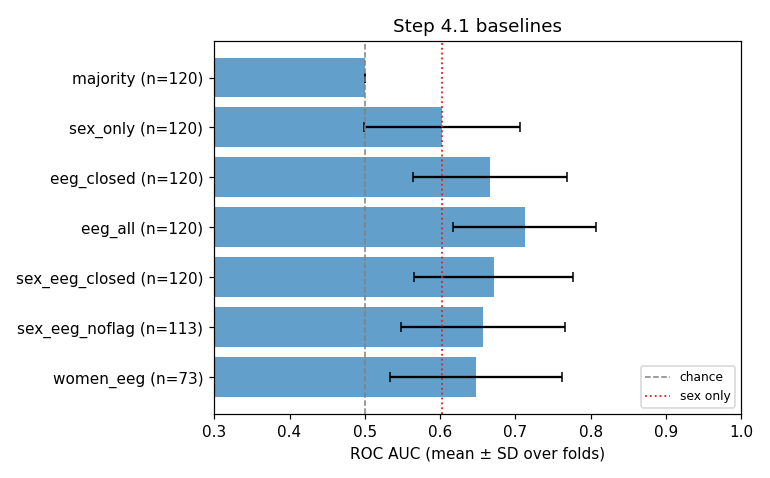 Baselines | 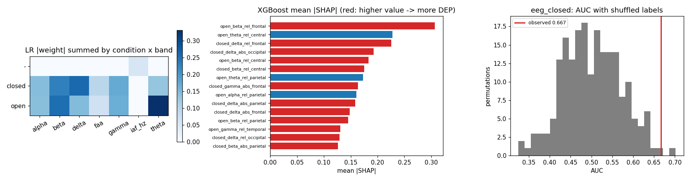 Weights, SHAP, permutation null |
| 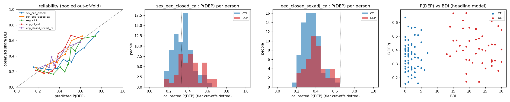 Calibration and risk tiers | 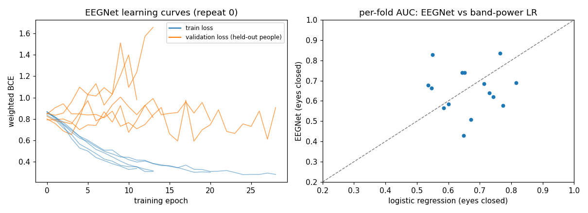 EEGNet vs logistic regression |
| 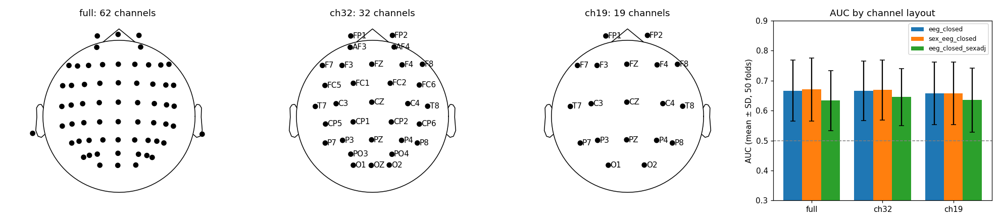 62 vs 32 vs 19 channels | 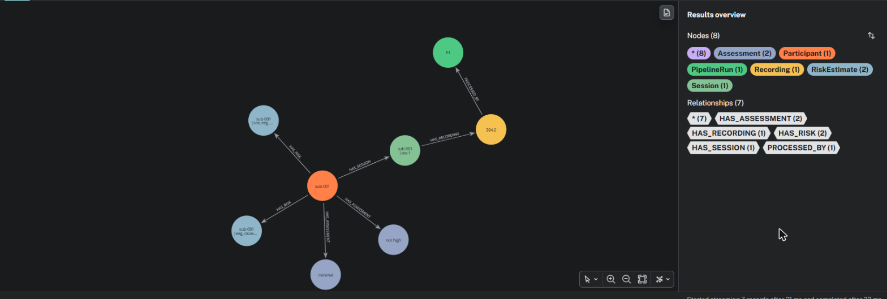 One participant in the study graph |

## Study graph

```
(:Dataset)<-[:IN_DATASET]-(:Participant {code, group, sex})-[:HAS_ASSESSMENT]->(:Assessment {instrument, score})
(:Participant)-[:HAS_SESSION]->(:Session)-[:HAS_RECORDING]->(:Recording {sfreq, n_channels})
(:Recording)-[:PROCESSED_BY]->(:PipelineRun {git_hash, ica_removed, epochs_rejected_pct})
(:Recording)-[:HAS_FEATURE]->(:FeatureValue {condition, value})-[:OF]->(:Biomarker {measure})
(:Biomarker)-[:IN_BAND]->(:FrequencyBand) ; (:Biomarker)-[:AT_REGION]->(:BrainRegion)
(:Model)-[:EVALUATED_ON]->(:Split) ; (:Model)-[:HAS_METRIC]->(:Metric) ; (:Model)-[:WEIGHTS]->(:Biomarker)
(:Participant)-[:HAS_RISK]->(:RiskEstimate {model, p_dep, tier})
```

19,952 nodes and 38,963 relationships. `Biomarker`, `FrequencyBand` and `BrainRegion` are shared with the literature graph (`(:Paper)-[:REPORTS]->(:Claim)-[:ABOUT]->(:Biomarker)`), so published claims and our own data meet on the same nodes; the university policy graph (`Document`, `Policy`, `Service`, `Rule`) lives in the same database. Example (query 7, does FAA replicate?):

```cypher
MATCH (p:Participant)-[:HAS_SESSION]->()-[:HAS_RECORDING]->()-[:HAS_FEATURE]->(v:FeatureValue {condition: 'closed'})
      -[:OF]->(:Biomarker {name: 'faa_F4_F3'})
RETURN p.group AS group, count(v) AS n, round(avg(v.value), 3) AS mean_faa
// CTL 75 -0.027 | DEP 45 0.045
```

All 10 queries with their expected answers: [`src/neurograph/graph/queries.py`](src/neurograph/graph/queries.py).

## Risk tiers and the DASS-21

The model is trained on design groups from the BDI-II (controls: stable BDI < 7; depressed: BDI ≥ 13; Cavanagh et al. 2019, PMID 31149639). Its calibrated P(DEP) is cut into pre-declared tiers: **low < 0.33 ≤ moderate < 0.66 ≤ high**. In this sample: low 46 people (28% DEP), moderate 72 (42% DEP), high 2 (both DEP).

Student screening often uses the **DASS-21** (depression, anxiety and stress) rather than the BDI-II. There is no validated one-to-one crosswalk from BDI-II or STAI to DASS-21, so the mapping below is a guide for re-labelling, not an equivalence:

| here | DASS-21 counterpart (score × 2) | what to do with DASS-21 data |
|---|---|---|
| CTL: BDI-II < 7 | Depression 0–9 (normal) | use as the low-risk class |
| DEP: BDI-II ≥ 13 | Depression ≥ 10 (mild or worse) | use as the target class; to mirror this extreme-group design, compare normal (0–9) with moderate or worse (≥ 14) and set mild aside, as BDI 7–12 was here |
| STAI ≥ 45 (reported only) | Anxiety ≥ 10 (moderate or worse) | train a separate anxiety model; here BDI and STAI correlate at ρ = 0.83, so they could not be separated |
| tiers from P(DEP) | — | recalibrate on local DASS-21 data before using any cut-off |

## LLM and RAG assistant

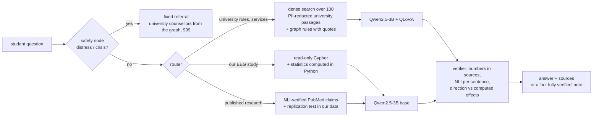

- **Intake (public pages only):** 23 approved university URLs (academic rules, fees and aid, 6 policy PDFs, support services, offices), one request every 2 s, no crawling; 19 documents → 100 chunks. Presidio + custom rules redact staff names, personal emails and phone numbers **before** anything is indexed (80 names, 51 emails; leak check 0; pytest cases for directories, honorifics, Bangladeshi mobiles, office contacts kept on purpose).
- **Retrieval:** BGE-small embeddings in embedded Qdrant. On 18 hand-written student questions, dense search finds the right page first 89% of the time (MRR 0.91) and beats BM25 (0.50) and a hybrid (0.67), so the agent uses dense search.
- **Knowledge graph:** the university policy graph (19 `Document`, 100 `Policy` sections, 6 `Service`, 9 `Rule` nodes whose quotes must appear verbatim on the page) and the literature graph (200 PubMed abstracts → 23 claims in a fixed schema → 16 NLI-verified, linked to the study graph's `Biomarker` nodes) live next to the study graph. None of the published directions replicates in our data; the verdicts are computed in Python (Welch t-test, Cohen's d), and the model only words them.
- **Safety:** the safety node runs before any model call. Crisis wording (always) and first-person distress lead to a fixed referral to the university's psychosocial counsellors (contacts read from the graph) and 999. The assistant never diagnoses, and the Cypher validator rejects any write or admin query.
- **Fine-tune:** QLoRA on Qwen2.5-3B-Instruct (4-bit NF4, LoRA r 16 on all projections, 1.7% of the weights) using 347 synthetic Q&A examples that a self-hosted Qwen2.5-7B wrote from the university passages. An answer is kept only if NLI finds it entailed by its passage, and 15% of examples have the right passage removed so the model learns to say so. Held out by chunk: held-out chunks never appear in training prompts, and test answers that an overlapping neighbour chunk also states are dropped.
- **Verifier:** every number must appear in the evidence, at least half the sentences must be entailed by a passage window (DeBERTa NLI), and no sentence about our depression group may state the opposite of the direction computed in Python.

### Evaluation

On 24 hand-written gold questions (11 university policy, 4 study-graph, 3 literature, 6 distress/crisis) and 55 held-out synthetic university questions from chunks never seen in training. Every model gets the same prompts and passages, with greedy decoding. The reference is a larger self-hosted model behind an API (Qwen3.5-9B via Ollama; no commercial key was available, see limitations). Full tables: [results §9](reports/results.md#9-evaluation-local-run-2026-10-21-scriptsrun_benchmarkpy-run_ragaspy-make_audit_sheetpy).

**Agent, end to end (gold questions):**

| model | policy | study | literature | facts (18) | verified | routing + safety | s / question |
|---|---|---|---|---|---|---|---|
| Qwen2.5-3B base | 10/11 | 4/4 | 2/3 | 16/18 | 0.61 | 24/24 | 1.1 |
| Qwen2.5-3B + QLoRA | 11/11 | 3/4 | 1/3 | 15/18 | 0.61 | 24/24 | 1.1 |
| QLoRA on policy, base on study/literature | 11/11 | 4/4 | 2/3 | 17/18 | 0.72 | 24/24 | 1.1 |
| routed, Q4_K_M GGUFs on CPU (as deployed) | 10/11 | 3/4 | 1/3 | 14/18 | 0.78 | 24/24 | 9.8 |
| Qwen3.5-9B via Ollama (self-hosted API) | 10/11 | 4/4 | 3/3 | 17/18 | 0.50 | 24/24 | 2.5 |

**Held-out university questions (answer generation only):**

| model | token F1 | faithful (NLI) | cites right passage | wrong refusals | correct refusals | words | s / answer |
|---|---|---|---|---|---|---|---|
| Qwen2.5-3B base | 0.60 | 0.61 | 0.18 | 0.00 | 0.46 | 23 | 0.8 |
| Qwen2.5-3B + QLoRA | 0.66 | 0.84 | 0.89 | 0.04 | 0.82 | 18 | 1.0 |
| routed, Q4_K_M GGUFs on CPU (as deployed) | 0.72 | 0.84 | 0.91 | 0.00 | 0.73 | 20 | 9.2 |
| Qwen3.5-9B via Ollama (self-hosted API) | 0.47 | 0.41 | 0.98 | 0.09 | 0.91 | 45 | 1.7 |

**Cost:** every row is self-hosted, so the API bill is $0. A question uses about 1,200 input and 25–70 output tokens, so with list prices in $ per million tokens, 1,000 questions cost (1,200 × input price + 50 × output price) / 1,000 dollars. Compute per 1,000 questions: 0.24–0.27 GPU-hours for the 3B models, 0.51 for the 9B reference, 2.5 CPU-hours for the deployed GGUFs.

**RAGAS** (Gemma 2 9B as the judge, a different model family from every contestant):

| set | model | faithfulness | answer relevancy | context precision |
|---|---|---|---|---|
| gold (18) | Qwen2.5-3B base | 0.97 ± 0.12 (n 18) | 0.80 ± 0.30 (n 18) | - |
| gold (18) | Qwen2.5-3B + QLoRA | 0.88 ± 0.27 (n 18) | 0.71 ± 0.30 (n 18) | - |
| gold (18) | QLoRA on policy only | 0.89 ± 0.26 (n 18) | 0.71 ± 0.31 (n 18) | - |
| gold (18) | deployed Q4_K_M GGUFs | 0.80 ± 0.38 (n 18) | 0.70 ± 0.36 (n 18) | - |
| gold (18) | Qwen3.5-9B (reference) | 0.91 ± 0.24 (n 18) | 0.62 ± 0.40 (n 18) | - |
| held-out (30) | Qwen2.5-3B base | 0.90 ± 0.30 (n 30) | 0.89 ± 0.18 (n 30) | 0.63 ± 0.30 (n 30) |
| held-out (30) | Qwen2.5-3B + QLoRA | 0.97 ± 0.19 (n 29) | 0.69 ± 0.27 (n 30) | 0.63 ± 0.30 (n 30) |
| held-out (30) | deployed Q4_K_M GGUFs | 0.98 ± 0.09 (n 29) | 0.74 ± 0.24 (n 30) | 0.63 ± 0.30 (n 30) |
| held-out (30) | Qwen3.5-9B (reference) | 0.96 ± 0.15 (n 30) | 0.78 ± 0.28 (n 30) | 0.63 ± 0.30 (n 30) |

Context precision is identical for every model by construction: it scores the passages in the prompt, which are the same for all models, with the right passage placed at a random position among four. It says nothing about the models. The two automatic faithfulness measures disagree on the gold policy answers (RAGAS: base 0.95, QLoRA 0.80; NLI verifier pass rate: base 0.55, QLoRA 0.73). The judge also makes visible mistakes: it scored a verbatim quote from the page (a07, "Re-evaluation of Scripts of Final Examinations is not allowed.") as 0.0 faithful, and identical base and routed literature answers got 1.00 vs 0.94. Differences under about 0.1 are therefore not meaningful at these sample sizes. Clearer signals: QLoRA's terse answers lower answer relevancy on held-out questions (0.69 vs 0.89), and the 4-bit deployment is the least faithful on the gold set (0.80). n 29 = a fragment answer with no checkable statement.

**Human audit:** a blind, stratified sheet of 50 answers with a rubric ([`eval/`](eval)); ratings by the project owner are pending.

### Demo

**Live demo:** _Hugging Face Space link to be added_ (free CPU: about 100 s per university answer, 40–50 s per research answer).

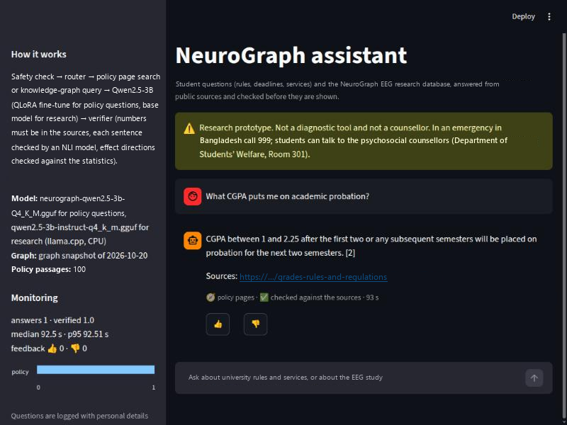

The Space runs one Docker image ([`space/`](space)): FastAPI (`/ask`, `/feedback`, `/stats`, `/health`) behind a Streamlit chat page. It uses the fine-tuned Q4_K_M GGUF for university questions and Qwen's own base Q4_K_M GGUF for research questions (llama.cpp), BGE + Qdrant, and the NLI verifier. The knowledge graph is either live (Neo4j secrets) or a 19 kB snapshot of aggregates and computed facts, never per-participant values. Every answer and 👍/👎 vote goes to a JSON-lines log with personal details redacted by the intake's Presidio rules (distress messages are not stored); the sidebar shows answers per route, verification rate, latency and feedback, and the log can be pushed to a private dataset every 10 minutes.

To deploy it under your own account:

1. Put the GGUF in a model repo: run notebook 70 with the secrets `HF_TOKEN` and `HF_REPO`, or `hf upload <user>/neurograph-qwen2.5-3b-gguf <path>/neurograph-qwen2.5-3b-Q4_K_M.gguf`.
2. Build the Space folder: `python -m scripts.export_graph_snapshot && python -m scripts.build_space`.
3. Create a Space (SDK **Docker**, free CPU) and upload the folder: `hf upload <user>/neurograph-assistant dist/space . --repo-type space`.
4. In Space settings, set the variable `GGUF_REPO=<user>/neurograph-qwen2.5-3b-gguf`. Optional: `LOG_DATASET` + `HF_TOKEN` to keep the logs; the `NEO4J_*` secrets for the live graph.

Run it locally: `docker build -t neurograph-space dist/space && docker run -p 7860:7860 -e GGUF_REPO=<user>/neurograph-qwen2.5-3b-gguf neurograph-space`, then open http://localhost:7860.

### Assistant limitations

- **Small, partly synthetic test sets:** 24 hand-written gold questions and 55 held-out synthetic questions (written by another model, so cleaner than real student questions). Differences of one or two answers are noise.
- **No commercial API in the benchmark:** no API key was available for this run, so the "API" row is a larger self-hosted model (Qwen3.5-9B through Ollama). The harness takes any OpenAI-compatible API (`configs/benchmark.yaml`), and the token counts give the cost at any list price.
- **Automatic judges are models too:** RAGAS uses a local 9B judge (Gemma 2), and faithfulness uses NLI; both are imperfect, and whole-answer NLI penalises long answers. The human audit is the reference, and its ratings are still pending.
- **The verifier can be wrong:** sentence-level NLI passed an over-generalised AI-policy answer ("ChatGPT is not permitted", but the policy allows limited cited use), and the direction check was added after a swapped direction slipped through. A "checked" badge means the sources were consulted, not that the answer is right.
- **Configuration chosen on the same gold set:** using the adapter on the policy route only was decided after seeing the 24 gold answers.
- **CPU demo is slow:** about 100 s per university answer on a free 2-vCPU Space, and the 4-bit GGUFs get 3 fewer gold facts than the fp16 setup (14 vs 17 of 18).
- **Snapshot of a changing website:** university pages were fetched on 2026-10-20/21; rules and contacts may change.
- **Not a counsellor:** the assistant answers information questions; it does not give medical, psychological or legal advice.

## Limitations

- **Small sample** (120 people, 45 DEP): fold-to-fold SD of AUC is ~0.10, and a shuffled-label run reached 0.70 by chance.
- **Sex confound:** sex predicts group on its own; the women-only model (n = 73) is not significant (p = 0.075). Sex adjustment is linear only.
- **Possible non-brain sources:** frontal delta (drowsy eye rolling) and frontal beta/gamma (forehead muscle) carry part of the signal.
- **Extreme-group design:** BDI 7–12 people are excluded, which inflates separability compared with a real screening population; the score does not rank severity within DEP.
- **One dataset, one site:** US recordings (60 Hz mains); the Mumtaz cross-dataset test is planned but not yet run.
- **Not clinical:** no prospective validation, no clinical decision should be based on this model.
- **Data quirks handled:** HEOG/VEOG swapped in every recording, EKG channel in 65 recordings, 7 QC-flagged subjects kept (sensitivity run included).
- **Assistant:** see [its own limitations](#assistant-limitations).

## Reproduce

Everything runs on free Kaggle notebooks that clone this repo and run `python -m scripts.<name>`. Each notebook's output is attached as input to the next ([`notebooks/`](notebooks)):

| notebook | steps | accelerator | input |
|---|---|---|---|
| `neurograph-20-preprocess` | download ds003478, labels, preprocessing, QC | CPU, ~2 h | — |
| `neurograph-30-features` | PSD, band power, FAA, regions | CPU | 20 |
| `neurograph-40-models` | baselines, permutation, XGBoost, calibration, tiers | CPU | 30 |
| `neurograph-41-eegnet` | EEGNet | GPU T4 | 20, 30 |
| `neurograph-42-channels` | 32/19-channel caps, MLflow | CPU | 20, 30, 40, 41 |
| `neurograph-50-graph` | Neo4j study graph + queries | CPU | 20, 30, 40, 42 + AuraDB secrets |
| `neurograph-60-intake` | university intake, index, policy graph, literature graph, agent eval | GPU T4 | AuraDB secrets |
| `neurograph-70-qlora` | Q&A pairs, QLoRA, base vs fine-tuned, agent eval, GGUF export | GPU T4 x2 | 60 + AuraDB secrets |

**On one local GPU instead:** [`scripts/local_pipeline.sh`](scripts/local_pipeline.sh) runs every step in order against a Docker Neo4j (paths and pins in its header; scikit-learn < 1.8, see section 4.7). Phase 9 (`run_benchmark`, `run_ragas`, `make_audit_sheet`) needs an Ollama server, or any OpenAI-compatible API, for the reference model and the judge ([`configs/benchmark.yaml`](configs/benchmark.yaml)).

Settings live in [`configs/`](configs); results in [`reports/results.md`](reports/results.md).

## Repository

```
configs/                YAML settings: dataset, preprocessing, features, models, graph, university URLs, RAG, fine-tune, app, benchmark
src/neurograph/eeg/         load, preprocess, ICA, epochs, features, QC
src/neurograph/models/      evaluation, calibration, confounds, explain, EEGNet
src/neurograph/graph/       schema, client, study / policy / literature loaders, queries
src/neurograph/ingest/      polite fetch, cleaning, Presidio PII redaction, chunking, Qdrant + BM25 index
src/neurograph/literature/  PubMed fetch, claim extraction (fixed schema), NLI check
src/neurograph/finetune/    Q&A dataset for QLoRA
src/neurograph/agent/       LangGraph workflow, safety node, graph tools, replication stats, verifier, LLM backends
src/neurograph/app/         FastAPI, Streamlit page, interaction log
scripts/                thin entry points (python -m scripts.<name>)
space/                  Hugging Face Space (Docker) files
eval/                   gold questions, human-audit sheet and guide
notebooks/              the Kaggle notebooks, one per phase
reports/                results.md and figures/
```

## Data and ethics

Data: OpenNeuro **ds003478** "EEG: Depression rest" (Cavanagh et al.), used under its public licence; participant codes are the dataset's own pseudonyms. No new human data is collected by this project.

The assistant uses only public university web pages and policy PDFs (an approved list of 23 URLs, one request every 2 s, no crawling) and public PubMed abstracts. Personal names, emails and phone numbers are redacted at intake, before anything is indexed or sent to a model; role-based office contacts are kept for referrals. Everything that touches study data runs on self-hosted models; an outside API may only receive public questions (`external: true` in the benchmark config). The fine-tuned model inherits the [Qwen Research License](https://huggingface.co/Qwen/Qwen2.5-3B-Instruct/blob/main/LICENSE) of Qwen2.5-3B-Instruct.
