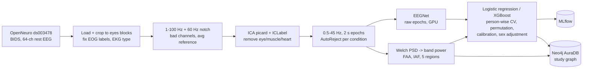

# NeuroGraph

An EEG mental-health research pipeline that ends in a knowledge graph: resting-state EEG from people with and without depression is cleaned, turned into brain-rhythm biomarkers, modelled with honest person-wise validation, and stored with full provenance in Neo4j. A knowledge-verified student-support assistant (LLM + RAG over the same graph) is being added on top.

> **Research and screening prototype. Not a diagnostic tool.** No new human data was collected; all EEG comes from a public, de-identified OpenNeuro dataset.

| Phase | What | Status |
|---|---|---|
| 0–1 | Kaggle setup, dataset audit, labels | ✅ |
| 2 | Preprocessing: filtering, ICA + ICLabel, epoching, AutoReject | ✅ 120/120 subjects |
| 3 | Features: band power, FAA, IAF, regions | ✅ 157 per person |
| 4 | Models: baselines, permutation tests, calibration, EEGNet, 32/19-channel caps, MLflow | ✅ |
| 5 | Study graph in Neo4j AuraDB + 10 Cypher queries | ✅ |
| 6–9 | Literature graph, university policy RAG, QLoRA assistant, evaluation | in progress (v2) |

---

## Where to find things

| Part | Code | Results |
|---|---|---|
| Preprocessing: filtering, ICA + ICLabel, epochs, AutoReject | [`src/neurograph/eeg/`](src/neurograph/eeg) | [QC](reports/results.md#2-preprocessing-qc-commit-4531cf3-120120-subjects-0-failures) |
| Features: band power, FAA, alpha peak, regions | [`eeg/features.py`](src/neurograph/eeg/features.py) | [features](reports/results.md#3-features-commit-17b8949) |
| Models: logistic regression, XGBoost, EEGNet, calibration | [`models/`](src/neurograph/models) | [all results](reports/results.md#4-models) |
| Risk tiers | [`models/calibrate.py`](src/neurograph/models/calibrate.py) | [risk tiers](#risk-tiers-and-the-dass-21) |
| Study graph (Neo4j) | [`graph/`](src/neurograph/graph) | [10 queries](src/neurograph/graph/queries.py) |

## Key findings

| model (person-level AUC, 50 folds) | AUC |
|---|---|
| majority class / sex only | 0.500 / 0.602 |
| **sex + eyes-closed EEG (pre-declared headline)** | **0.671 ± 0.105** |
| eyes-closed EEG with sex regressed out | 0.633 ± 0.100 (permutation p = 0.030) |
| EEGNet on raw EEG (same 15 folds as LR 0.665) | 0.653 ± 0.111 |
| same model, 32-channel / 19-channel cap | 0.669 / 0.658 |

1. **There is a modest EEG signal for depression, and most of it is not sex.** DEP participants are 73% female vs 53% of controls, and sex alone gives AUC 0.60. Removing sex's effect from every feature inside the training folds lowers EEG from 0.667 to 0.633, still above 97% of shuffled-label runs.
2. **Deep learning does not help at n = 120.** EEGNet matches band-power logistic regression and overfits within ~2 epochs.
3. **A 32- or 19-channel cap loses nothing measurable** (ΔAUC within ±0.013): the signal is broad and regional, so it does not need a dense 64-channel cap.
4. **Calibration fixes the percentages, not the separation.** Platt scaling inside folds brings mean predicted risk from 0.47 to the true 0.375 (slope 0.66 → 1.04), but almost nobody reaches "high risk", and the score does not track severity within DEP.
5. **The classic frontal alpha asymmetry finding does not replicate** here (F4–F3 slightly positive in DEP, opposite to the usual direction).

Full tables with commits: [`reports/results.md`](reports/results.md).

## Pipeline



- **Validation:** StratifiedGroupKFold by person, 5 folds × 10 repeats, the same folds for every model; imputation, scaling, C tuning, sex adjustment and calibration are all fitted inside training folds only; no feature selection on the full data.
- **Honesty checks:** majority and sex-only baselines, paired fold-by-fold comparisons, 200-shuffle permutation tests, a sensitivity run without QC-flagged people, a women-only model, and a pre-declared headline model to avoid picking the best of many.
- **Reproducibility:** fixed seeds, YAML configs, git hash stored on every pipeline run, MLflow runs for every Phase 4 model.

## Figures

| | |
|---|---|
|  Preprocessing QC, 120 subjects |  Eyes-closed spectra, CTL vs DEP |
|  Alpha-peak sanity checks |  FAA, muscle and sex checks |
|  Baselines |  Weights, SHAP, permutation null |
|  Calibration and risk tiers |  EEGNet vs logistic regression |
|  62 vs 32 vs 19 channels |  One participant in the study graph |

## Study graph

```
(:Dataset)<-[:IN_DATASET]-(:Participant {code, group, sex})-[:HAS_ASSESSMENT]->(:Assessment {instrument, score})
(:Participant)-[:HAS_SESSION]->(:Session)-[:HAS_RECORDING]->(:Recording {sfreq, n_channels})
(:Recording)-[:PROCESSED_BY]->(:PipelineRun {git_hash, ica_removed, epochs_rejected_pct})
(:Recording)-[:HAS_FEATURE]->(:FeatureValue {condition, value})-[:OF]->(:Biomarker {measure})
(:Biomarker)-[:IN_BAND]->(:FrequencyBand) ; (:Biomarker)-[:AT_REGION]->(:BrainRegion)
(:Model)-[:EVALUATED_ON]->(:Split) ; (:Model)-[:HAS_METRIC]->(:Metric) ; (:Model)-[:WEIGHTS]->(:Biomarker)
(:Participant)-[:HAS_RISK]->(:RiskEstimate {model, p_dep, tier})
```

19,952 nodes and 38,963 relationships. `Biomarker`, `FrequencyBand` and `BrainRegion` are shared with the upcoming literature graph, so published claims and our own data meet on the same nodes. Example (query 7, does FAA replicate?):

```cypher
MATCH (p:Participant)-[:HAS_SESSION]->()-[:HAS_RECORDING]->()-[:HAS_FEATURE]->(v:FeatureValue {condition: 'closed'})
      -[:OF]->(:Biomarker {name: 'faa_F4_F3'})
RETURN p.group AS group, count(v) AS n, round(avg(v.value), 3) AS mean_faa
// CTL 75 -0.027 | DEP 45 0.045
```

All 10 queries with their expected answers: [`src/neurograph/graph/queries.py`](src/neurograph/graph/queries.py).

## Risk tiers and the DASS-21

The model is trained on design groups from the BDI-II (controls: stable BDI < 7; depressed: BDI ≥ 13; Cavanagh et al. 2019, PMID 31149639). Its calibrated P(DEP) is cut into pre-declared tiers: **low < 0.33 ≤ moderate < 0.66 ≤ high**. In this sample: low 46 people (28% DEP), moderate 72 (42% DEP), high 2 (both DEP).

Student screening often uses the **DASS-21** (depression, anxiety and stress) rather than the BDI-II. There is no validated one-to-one crosswalk from BDI-II or STAI to DASS-21, so the mapping below is a guide for re-labelling, not an equivalence:

| here | DASS-21 counterpart (score × 2) | what to do with DASS-21 data |
|---|---|---|
| CTL: BDI-II < 7 | Depression 0–9 (normal) | use as the low-risk class |
| DEP: BDI-II ≥ 13 | Depression ≥ 10 (mild or worse) | use as the target class; to mirror this extreme-group design, compare normal (0–9) with moderate or worse (≥ 14) and set mild aside, as BDI 7–12 was here |
| STAI ≥ 45 (reported only) | Anxiety ≥ 10 (moderate or worse) | train a separate anxiety model; here BDI and STAI correlate at ρ = 0.83, so they could not be separated |
| tiers from P(DEP) | — | recalibrate on local DASS-21 data before using any cut-off |

## Limitations

- **Small sample** (120 people, 45 DEP): fold-to-fold SD of AUC is ~0.10, and a shuffled-label run reached 0.70 by chance.
- **Sex confound:** sex predicts group on its own; the women-only model (n = 73) is not significant (p = 0.075). Sex adjustment is linear only.
- **Possible non-brain sources:** frontal delta (drowsy eye rolling) and frontal beta/gamma (forehead muscle) carry part of the signal.
- **Extreme-group design:** BDI 7–12 people are excluded, which inflates separability compared with a real screening population; the score does not rank severity within DEP.
- **One dataset, one site:** US recordings (60 Hz mains); the Mumtaz cross-dataset test is planned but not yet run.
- **Not clinical:** no prospective validation, no clinical decision should be based on this model.
- **Data quirks handled:** HEOG/VEOG swapped in every recording, EKG channel in 65 recordings, 7 QC-flagged subjects kept (sensitivity run included).

## Reproduce

Everything runs on free Kaggle notebooks that clone this repo and run `python -m scripts.<name>`. Each notebook's output is attached as input to the next ([`notebooks/`](notebooks)):

| notebook | steps | accelerator | input |
|---|---|---|---|
| `neurograph-20-preprocess` | download ds003478, labels, preprocessing, QC | CPU, ~2 h | — |
| `neurograph-30-features` | PSD, band power, FAA, regions | CPU | 20 |
| `neurograph-40-models` | baselines, permutation, XGBoost, calibration, tiers | CPU | 30 |
| `neurograph-41-eegnet` | EEGNet | GPU T4 | 20, 30 |
| `neurograph-42-channels` | 32/19-channel caps, MLflow | CPU | 20, 30, 40, 41 |
| `neurograph-50-graph` | Neo4j study graph + queries | CPU | 20, 30, 40, 42 + AuraDB secrets |

Settings live in [`configs/`](configs); results in [`reports/results.md`](reports/results.md).

## Repository

```
configs/            YAML settings: dataset, preprocessing, features, models, graph
src/neurograph/eeg/     load, preprocess, ICA, epochs, features, QC
src/neurograph/models/  evaluation, calibration, confounds, explain, EEGNet
src/neurograph/graph/   schema, client, study loader, queries
scripts/            thin entry points (python -m scripts.<name>)
notebooks/          the Kaggle notebooks, one per phase
reports/            results.md and figures/
```

## LLM and RAG assistant (in progress)

Coming in README v2: literature graph from PubMed with NLI-verified claims, university public-policy RAG with PII redaction (Presidio + Qdrant), a QLoRA fine-tuned Qwen assistant, a LangGraph agent whose answers are checked against this graph, and a benchmark against a commercial LLM API.

## Data and ethics

Data: OpenNeuro **ds003478** "EEG: Depression rest" (Cavanagh et al.), used under its public licence; participant codes are the dataset's own pseudonyms. No new human data is collected by this project.
